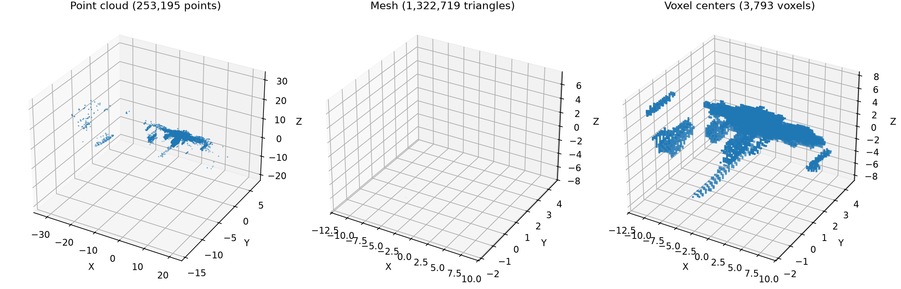
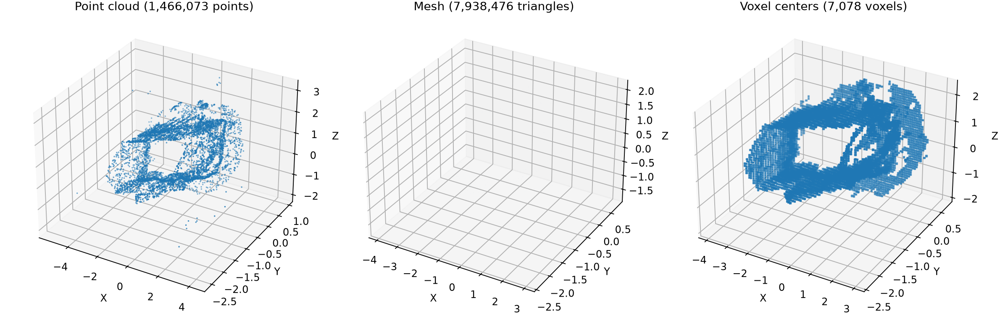
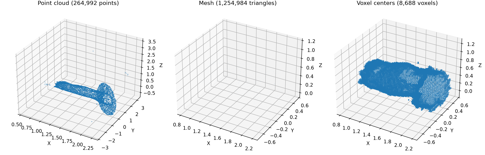
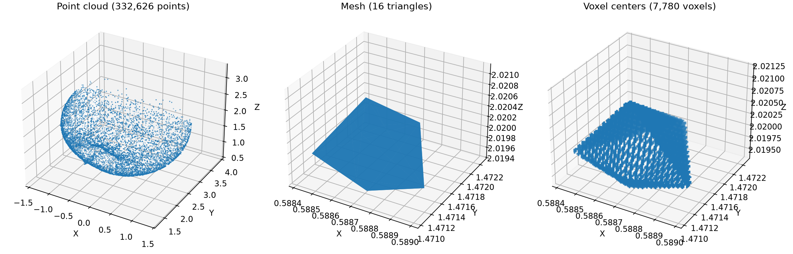

# Multi-View 3D Reconstruction and Multi-Representation Geometric Modeling

[](https://www.python.org/)
[](https://developer.nvidia.com/cuda-zone)
[](http://www.open3d.org/)
[](3D_Reconstruction_Colab.ipynb)
[](docs/report.pdf)
[](demo.mp4)
[](docs/pipeline.md)
[](https://iiitdwd.ac.in/)

An end-to-end, fully reproducible 3D Computer Vision pipeline that transforms unconstrained multi-view 2D photographs into four complementary geometric representations:
1. **Sparse Point Cloud** ($\mathcal{P}_{\mathrm{sparse}}$) via SIFT keypoint triangulation and Levenberg-Marquardt bundle adjustment.
2. **Dense Point Cloud** ($\mathcal{P}_{\mathrm{dense}}$) via CUDA-accelerated PatchMatch Multi-View Stereo (MVS) with photometric and geometric consistency filtering.
3. **Continuous Polygonal Mesh** ($\mathcal{M} = (V, F)$) via Screened Poisson Surface Reconstruction with indicator function octree solving.
4. **Regular Volumetric Voxel Grid** ($\mathcal{G} \subset \mathbb{Z}^3$) via spatial bounding box occupancy discretization.

The repository includes a **zero-dependency interactive Three.js WebGL viewer**, automated **neural foreground masking (rembg)**, comprehensive **quantitative benchmarking across multiple datasets**, an **IEEE Conference Report**, a **3-minute demonstration video**, a **Google Colab Cloud Notebook**, and deep-dive **technical documentation in [`docs/`](docs/)**.

---

## 📑 Table of Contents
- [👥 Project Team & Author Contributions](#-project-team--author-contributions)
- [📸 Visual Showcase & 3D Gallery](#-visual-showcase--3d-gallery)
- [📦 Supported 3D Representations](#-supported-3d-representations)
- [🎯 Deliverables Quick Access (Clickable Links)](#-deliverables-quick-access-clickable-links)
- [⚡ Quick Start: Interactive 3D Web Viewer](#-quick-start-interactive-3d-web-viewer)
- [🛠️ Local Installation & Hardware Setup](#️-local-installation--hardware-setup)
- [☁️ Alternative: Google Colab Notebook (Cloud GPU)](#️-alternative-google-colab-notebook-cloud-gpu)
- [📥 Reconstructing Custom Images & Videos](#-reconstructing-custom-images--videos)
- [🔄 Running Pipeline Reconstructions Locally](#-running-pipeline-reconstructions-locally)
- [🖥️ Native Desktop 3D Inspection (Open3D)](#️-native-desktop-3d-inspection-open3d)
- [📊 Quantitative Benchmark Results](#-quantitative-benchmark-results)
- [🔬 Voxel Discretization Ablation Analysis](#-voxel-discretization-ablation-analysis)
- [⚠️ Error Analysis & Pathological Failure Modes](#️-error-analysis--pathological-failure-modes)
- [📚 Technical Documentation & Deep Dives (`docs/`)](#-technical-documentation--deep-dives-docs)
- [🚀 Git & GitHub Upload Guide](#-git--github-upload-guide)
- [📁 Repository Directory Structure](#-repository-directory-structure)

---

## 👥 Project Team & Author Contributions

**Institution**: Indian Institute of Information Technology Dharwad (IIIT Dharwad)  
**Department**: Department of Computer Science & Engineering  
**Course**: 3D Computer Vision  

| Team Member | Roll Number | Institutional Email | Divided Project Roles & Responsibilities |
| :--- | :--- | :--- | :--- |
| **Kothapally Anjan Reddy** | `23bcs071` | [23bcs071@iiitdwd.ac.in](mailto:23bcs071@iiitdwd.ac.in) | **Structure from Motion (SfM) Pipeline**: SIFT feature detection, exhaustive pair matching, epipolar RANSAC two-view initialization, incremental camera pose tracking, and Levenberg-Marquardt bundle adjustment optimization. |
| **Babhale Rohan Laxmikant** | `23bcs026` | [23bcs026@iiitdwd.ac.in](mailto:23bcs026@iiitdwd.ac.in) | **Dense Multi-View Stereo (MVS)**: CUDA PatchMatch depth and surface normal inference, photometric/geometric consistency filtering, automated neural `rembg` foreground masking, and dense point cloud fusion. |
| **Gujja Sri Varshith Rao** | `23bcs051` | [23bcs051@iiitdwd.ac.in](mailto:23bcs051@iiitdwd.ac.in) | **3D Representations & Web Viewer**: Screened Poisson surface reconstruction, normal estimation, Open3D volumetric voxel grid discretization, and interactive Three.js WebGL localhost viewer integration. |
| **Koushik C** | `23bcs073` | [23bcs073@iiitdwd.ac.in](mailto:23bcs073@iiitdwd.ac.in) | **Benchmarking, Error Analysis & Report**: Quantitative benchmarking across 4 datasets, stage-by-stage latency analysis, voxel resolution ablation study, failure mode diagnosis, and IEEE project report authoring. |

---

## 📸 Visual Showcase & 3D Gallery

Below are the visual reconstructions across our primary evaluation datasets, showing the progression from **Dense Point Cloud** $\to$ **Watertight Poisson Surface Mesh** $\to$ **Volumetric Voxel Occupancy Grid**:

### 🦉 1. Owl Sculpture (Tabletop Masked Reconstruction)
> **Stats**: 30 Views | 253,195 Dense Points | 1,322,719 Triangles | 3,793 Occupied Voxels  

*Left: Dense Multi-View Stereo Point Cloud | Center: Continuous Screened Poisson Mesh | Right: Volumetric Occupancy Voxel Grid ($s = 0.01 D$)*

---

### 🏛️ 2. South Building (Large-Scale Architectural Monument)
> **Stats**: 128 Views | 1,466,073 Dense Points | 7,938,476 Triangles | 7,078 Occupied Voxels  

*Left: Dense Architectural Point Cloud | Center: High-Fidelity Polygonal Mesh | Right: Discrete Voxel Grid*

---

### 🐕 3. Dog Figurine (Organic Turntable Object)
> **Stats**: 72 Views | 264,992 Dense Points | 1,254,984 Triangles | 8,688 Occupied Voxels  

*Left: Dense Point Cloud | Center: Watertight Poisson Surface Mesh | Right: Spatial Voxel Grid*

---

### 🍎 4. Apple (Specular Photometric Breakdown Baseline)
> **Stats**: 72 Views | 332,626 Dense Points | 16 Degenerate Triangles *(Diagnostic Failure Analysis)*  

*Demonstration of non-Lambertian specular failure: dense points are recovered, but shifting waxy specular glare breaks surface normal consistency, causing Poisson meshing collapse.*

---

## 📦 Supported 3D Representations

Our pipeline unifies four complementary geometric paradigms to address distinct engineering requirements:

| 3D Representation | Underlying Primitives | Memory / File Scale | Core Advantages | Best Applications |
| :--- | :--- | :--- | :--- | :--- |
| **1. Sparse Point Cloud** ($\mathcal{P}_s$) | 3D Landmark Points $(x,y,z) + \mathbf{c}$ | Ultra-lightweight (0.5–3 MB) | Instant computation, reveals camera orbit and scene bounds | Camera calibration, AR tracking, visual odometry |
| **2. Dense Point Cloud** ($\mathcal{P}_d$) | Filtered Depth Points $(x,y,z) + \mathbf{c} + \mathbf{n}$ | Moderate (15–80 MB) | Faithful high-frequency surface detail, no mesh topology errors | Photogrammetric surveying, inspection, neural radiance field seeding |
| **3. Continuous Poisson Mesh** ($\mathcal{M}$) | Vertices $V$ & Triangle Faces $F$ | Large (50–195 MB) | Continuous, watertight manifold topology, realistic shading | Real-time graphics rendering, 3D printing, physics collision |
| **4. Volumetric Voxel Grid** ($\mathcal{G}$) | Uniform Spatial Cubes $\mathbb{Z}^3$ | Extremely compact (2–180 KB) | Constant $O(1)$ spatial occupancy queries, bounded memory | Robotic path planning, collision volumes, Minecraft/Lego voxelization |

---

## 🎯 Deliverables Quick Access (Clickable Links)

Click any hyperlink below to navigate directly to that artifact or directory on GitHub:

| Deliverable Category | Target Artifact / Directory | Format / Type | Description |
| :--- | :--- | :--- | :--- |
| 📄 **Academic Report** | [`docs/report.pdf`](docs/report.pdf) | PDF (6 Pages) | Publication-ready IEEE Conference double-column project report |
| 📝 **LaTeX Source** | [`docs/report.tex`](docs/report.tex) | LaTeX (.tex) | Full IEEE double-column LaTeX source code with citations |
| 🎥 **Demo Walkthrough**| [`demo.mp4`](demo.mp4) | Video (MP4) | 3.00-minute demonstration video showing 360° orbital 3D models |
| ☁️ **Cloud Notebook** | [`3D_Reconstruction_Colab.ipynb`](3D_Reconstruction_Colab.ipynb) | Jupyter Notebook | 1-Click Google Colab cloud execution on free NVIDIA T4 GPU |
| 📥 **Central Inputs** | [`inputs/`](inputs/) & [`inputs/README.md`](inputs/README.md) | Directory + Guide | Central inputs folder containing image datasets and video recordings |
| 📸 **Input Photographs**| [`inputs/images/`](inputs/images/) & [Guide](inputs/images/README.md) | Directory | Photo collections: [`owl`](inputs/images/owl-images/), [`Building`](inputs/images/Building/), [`Dog RGB`](inputs/images/Dog_RGB/), [`Apple`](inputs/images/Apple/), [`Cat RGB`](inputs/images/Cat_RGB/) |
| 📹 **Input Videos** | [`inputs/videos/`](inputs/videos/) & [Guide](inputs/videos/README.md) | Directory | Video input drop folder with automated frame extraction guide |
| 📦 **3D Outputs** | [`outputs/`](outputs/) | Directory | Complete reconstructed 3D models (see breakdown below) |
| 🌐 **WebGL Client** | [`web/`](web/) | HTML / Three.js | Frontend viewer interface ([`index.html`](web/index.html), [`gallery.html`](web/gallery.html)) |
| 💻 **Source Code** | [`src/`](src/) | Python Module | Core pipeline logic ([`pipeline.py`](src/pipeline.py), [`viewer.py`](src/viewer.py), [`preprocess_images.py`](src/preprocess_images.py), [`representations.py`](src/representations.py)) |
| 📚 **Technical Docs** | [`docs/`](docs/) | Markdown | Mathematical formulations ([`docs/pipeline.md`](docs/pipeline.md)), benchmarks ([`docs/benchmarks.md`](docs/benchmarks.md)), troubleshooting ([`docs/troubleshooting.md`](docs/troubleshooting.md)) |

### 📦 Pre-Reconstructed 3D Models in [`outputs/`](outputs/):
- 🦉 **Owl Sculpture (30 Views)**: [`outputs/owl/`](outputs/owl/)  
  *Artifacts*: [`point_cloud.ply`](outputs/owl/point_cloud.ply) (253K points) | [`mesh.ply`](outputs/owl/mesh.ply) (1.32M faces) | [`voxels.npz`](outputs/owl/voxels.npz) | [`preview.jpg`](outputs/owl/preview.jpg) | [`comparison.png`](outputs/owl/comparison.png)
- 🏛️ **South Building Architecture (128 Views)**: [`outputs/Building/`](outputs/Building/)  
  *Artifacts*: [`point_cloud.ply`](outputs/Building/point_cloud.ply) (1.47M points) | [`mesh.ply`](outputs/Building/mesh.ply) (7.94M faces) | [`voxels.npz`](outputs/Building/voxels.npz) | [`preview.jpg`](outputs/Building/preview.jpg) | [`comparison.png`](outputs/Building/comparison.png)
- 🐕 **Dog Figurine (72 Views)**: [`outputs/dog/`](outputs/dog/)  
  *Artifacts*: [`point_cloud.ply`](outputs/dog/point_cloud.ply) (265K points) | [`mesh.ply`](outputs/dog/mesh.ply) (1.25M faces) | [`voxels.npz`](outputs/dog/voxels.npz) | [`preview.jpg`](outputs/dog/preview.jpg) | [`comparison.png`](outputs/dog/comparison.png)
- 🍎 **Apple Specular Baseline (72 Views)**: [`outputs/Apple/`](outputs/Apple/)  
  *Artifacts*: [`point_cloud.ply`](outputs/Apple/point_cloud.ply) (333K points) | [`mesh.ply`](outputs/Apple/mesh.ply) (Failure baseline) | [`voxels.npz`](outputs/Apple/voxels.npz) | [`preview.jpg`](outputs/Apple/preview.jpg) | [`comparison.png`](outputs/Apple/comparison.png)
- 🐱 **Cat RGB Dataset (108 Views)**: [`outputs/Cat_white/`](outputs/Cat_white/)  
  *Artifacts*: [`point_cloud.ply`](outputs/Cat_white/point_cloud.ply) | [`mesh.ply`](outputs/Cat_white/mesh.ply) | [`preview.jpg`](outputs/Cat_white/preview.jpg)
- 🐶 **Dog RGB Dataset (72 Views)**: [`outputs/Dog_white/`](outputs/Dog_white/)  
  *Artifacts*: [`point_cloud.ply`](outputs/Dog_white/point_cloud.ply) | [`mesh.ply`](outputs/Dog_white/mesh.ply) | [`preview.jpg`](outputs/Dog_white/preview.jpg)

---

## ⚡ Quick Start: Interactive 3D Web Viewer

Inspect all reconstructed 3D models interactively in your web browser with zero configuration:

```powershell
# Start the local Three.js WebGL server (serves outputs/ directory)
python -m src.viewer --port 8000
```
Then open your browser to: **`http://localhost:8000`**

### In-Viewer Controls & Features:
- **Dataset Switcher**: Seamlessly switch between all pre-computed models:
  - 🦉 **Owl Sculpture** (30 images, fine feather details)
  - 🏛️ **South Building** (128 images, 1.47M points, 7.94M triangles)
  - 🐕 **Dog Figurine** (72 images, organic turntable figurine)
  - 🍎 **Apple** (72 images, specular breakdown baseline)
  - 🐱 **Cat RGB** & 🐶 **Dog RGB**
- **Representation Toggles**:
  - 🟢 **Dense Point Cloud**: Full photometric point cloud with surface normals.
  - 🔵 **Poisson Mesh**: Smooth, watertight triangulated surface mesh.
  - 🟨 **Voxel Grid**: Interactive 3D spatial occupancy cubes.
  - ⚪ **Sparse SfM**: Triangulated keypoints and registered camera pyramid frustums.
- **Mouse Navigation**:
  - **Left Click + Drag**: Orbit / Rotate 360° around target.
  - **Right Click + Drag**: Pan camera horizontally and vertically.
  - **Scroll Wheel**: Smooth zoom in / out.
- **Rendering Modes**: Toggle between RGB Vertex Color, Surface Normal Shading, Uniform Clay, and Wireframe.

---

## 🛠️ Local Installation & Hardware Setup

### 1. Hardware & System Prerequisites
- **Operating System**: Windows 10/11 (64-bit) or Linux (Ubuntu 20.04/22.04).
- **Python**: Version 3.10, 3.11, or 3.12 (64-bit).
- **GPU**: NVIDIA GPU with CUDA compute capability $\ge 6.0$ (e.g., GTX 1060+, RTX 3050/3060/4060+).
- **COLMAP**: Standalone CUDA-enabled COLMAP binary:
  - Windows: Download [COLMAP-3.8-windows-cuda.zip](https://github.com/colmap/colmap/releases) and extract (e.g. to `D:\tools\COLMAP\bin\colmap.exe` or add to system `PATH`).
  - Linux: `sudo apt install colmap`

### 2. Environment Setup (From Scratch)

#### 📥 Step 1: Choose Your Cloning Mode (Save Bandwidth & Disk Space)

Depending on your internet bandwidth and storage, choose one of the following cloning options:

> **💡 Note on Repository Size**:  
> The 10+ GB of intermediate COLMAP PatchMatch depth maps (`.bin` files) are permanently excluded via `.gitignore` and **never uploaded to GitHub**.  
> The code and viewer are **under 2 MB**. The pre-reconstructed 3D models (`.ply`, `.npz`) use Git LFS so you can easily choose whether to download them.

* **Option A: Fast / Code-Only Clone (< 2 MB, 2 Seconds) — *Recommended for Low Bandwidth***:  
  Downloads all source code, WebGL viewer, Google Colab notebook, and documentation, while **skipping all heavy 3D mesh files**:
  ```bash
  GIT_LFS_SKIP_SMUDGE=1 git clone https://github.com/Kothapally-Anjan-Reddy/Multi-View-Geom-Modeling.git
  cd Multi-View-Geom-Modeling
  ```
  *(If you later want to download just one specific 3D model, e.g. Owl, run: `git lfs pull --include="outputs/owl/*"`)*

* **Option B: Full Clone with All Pre-Reconstructed 3D Models (~350 MB)**:  
  Downloads the code plus all 6 pre-reconstructed 3D models (`owl`, `Building`, `dog`, `Apple`, `Cat`, `Dog`):
  ```bash
  git clone https://github.com/Kothapally-Anjan-Reddy/Multi-View-Geom-Modeling.git
  cd Multi-View-Geom-Modeling
  git lfs pull
  ```

#### 🐍 Step 2: Create Virtual Environment & Install Dependencies

```powershell
# Create and activate Python virtual environment
python -m venv .venv
.\.venv\Scripts\Activate.ps1    # On Linux/macOS: source .venv/bin/activate

# Upgrade pip and install required packages
pip install --upgrade pip
pip install -r requirements.txt

# Verify installation
python -c "import open3d, cv2, numpy, rembg, flask; print('✓ All dependencies installed successfully!')"
```

---

## ☁️ Alternative: Google Colab Notebook (Cloud GPU)

Don't have a dedicated NVIDIA GPU on your local machine? You can run the entire pipeline on Google's cloud GPUs for free!

We have prepared a self-contained notebook: **[`3D_Reconstruction_Colab.ipynb`](3D_Reconstruction_Colab.ipynb)**

### How to Run on Colab:
1. Open [Google Colab](https://colab.research.google.com/).
2. Click **Upload** and select [`3D_Reconstruction_Colab.ipynb`](3D_Reconstruction_Colab.ipynb) from this repository.
3. Connect to a GPU runtime: **Runtime** $\rightarrow$ **Change runtime type** $\rightarrow$ select **T4 GPU** (Free).
4. Run the notebook cells sequentially:
   - **Cell 1–3**: Verifies CUDA acceleration and installs COLMAP via Ubuntu `apt`.
   - **Cell 4–5**: Installs Python dependencies (`open3d`, `rembg`, `opencv-python`, etc.).
   - **Cell 6–8**: Selects a built-in dataset or lets you upload your own zipped photos.
   - **Cell 9–12**: Runs automated foreground segmentation and executes end-to-end 3D reconstruction.
   - **Cell 13–16**: Visualizes the reconstructed 3D Point Cloud and Poisson Mesh directly inside the browser using interactive **Plotly 3D**.
   - **Cell 17–19**: Bundles all outputs (`point_cloud.ply`, `mesh.ply`, `voxels.ply`) into a convenient `.zip` for instant download.

---

## 📥 Reconstructing Custom Images & Videos

All inputs are managed through the central [`inputs/`](inputs/) directory:

### Option 1: Reconstruct from Photographs ([`inputs/images/`](inputs/images/))
1. Create a folder under [`inputs/images/<my_object>/`](inputs/images/) and add 30–100+ photos.
2. Run reconstruction:

```powershell
# Case A: Tabletop object with automated background masking (rembg)
python -m src.preprocess_images --images "inputs\images\my_object" --output "prepared\my_object" --max-image-size 1000
python -m src.pipeline --images "prepared\my_object\images" --masks "prepared\my_object\masks" --output "outputs\my_object" --gpu on --matcher exhaustive --max-image-size 1000

# Case B: Architecture, rooms, or full outdoor scenes (unmasked)
python -m src.pipeline --images "inputs\images\my_object" --output "outputs\my_object" --gpu on --matcher exhaustive --max-image-size 1000
```

### Option 2: Reconstruct from Video ([`inputs/videos/`](inputs/videos/))
1. Place your video file in [`inputs/videos/my_video.mp4`](inputs/videos/).
2. Extract sharp keyframes automatically:

```powershell
python -m src.extract_frames --video "inputs\videos\my_video.mp4" --output "inputs\images\my_video_frames" --max-frames 60
```
3. Run reconstruction using the extracted frames in `inputs\images\my_video_frames`.

Once finished, refresh `python -m src.viewer --port 8000` to orbit your new 3D model in your browser!

---

## 🔄 Running Pipeline Reconstructions Locally

Below are the exact copyable commands to re-run any of the benchmark datasets included in the repository:

### 1. Owl Sculpture (Tabletop Masked Reconstruction)
```powershell
# Preprocess & mask
python -m src.preprocess_images --images "inputs\images\owl-images" --output "prepared\owl" --max-image-size 1000

# Full reconstruction
python -m src.pipeline --images "prepared\owl\images" --masks "prepared\owl\masks" --output "outputs\owl" --gpu on --matcher exhaustive --max-image-size 1000
```

### 2. South Building (Large-Scale Architecture, Unmasked)
```powershell
# Architectural scene preserves full environment (no masking needed)
python -m src.pipeline --images "inputs\images\Building" --output "outputs\Building" --gpu on --matcher exhaustive --max-image-size 1000
```

### 3. Dog Figurine (Organic Turntable Object)
```powershell
python -m src.preprocess_images --images "inputs\images\Dog_RGB" --output "prepared\dog" --max-image-size 1000
python -m src.pipeline --images "prepared\dog\images" --masks "prepared\dog\masks" --output "outputs\dog" --gpu on --matcher exhaustive --max-image-size 1000
```

### 4. Apple (Specular Photometric Breakdown Baseline)
```powershell
python -m src.preprocess_images --images "inputs\images\Apple" --output "prepared\Apple" --max-image-size 1000
python -m src.pipeline --images "prepared\Apple\images" --masks "prepared\Apple\masks" --output "outputs\Apple" --gpu on --matcher exhaustive --max-image-size 1000
```

### ⏱️ Fast Mode: Sparse SfM-Only (< 1 Minute)
If you only need camera poses, intrinsics, and sparse keypoints without waiting for dense MVS:
```powershell
python -m src.pipeline --images "inputs\images\owl-images" --output "outputs\owl_fast" --gpu on --matcher exhaustive --skip-dense
```

---

## 🖥️ Native Desktop 3D Inspection (Open3D)

To open a hardware-accelerated desktop 3D window using Open3D:

```powershell
# Inspect Dense Point Cloud (Owl)
python -c "import open3d as o3d; pcd = o3d.io.read_point_cloud('outputs/owl/point_cloud.ply'); o3d.visualization.draw_geometries([pcd], window_name='Owl Dense Point Cloud')"

# Inspect Watertight Poisson Surface Mesh (Owl)
python -c "import open3d as o3d; mesh = o3d.io.read_triangle_mesh('outputs/owl/mesh.ply'); mesh.compute_vertex_normals(); o3d.visualization.draw_geometries([mesh], window_name='Owl Poisson Mesh')"

# Inspect South Building (1.47M Points)
python -c "import open3d as o3d; pcd = o3d.io.read_point_cloud('outputs/Building/point_cloud.ply'); o3d.visualization.draw_geometries([pcd], window_name='South Building 3D Cloud')"
```

---

## 📊 Quantitative Benchmark Results

The pipeline was quantitatively evaluated across four diverse real-world datasets spanning distinct visual scales, camera geometries, and surface material properties:

### Table I: Master Geometric Performance & Density Metrics

| Quantitative Metric | Owl (Sculpture) | South Building (Architecture) | Dog (Organic Figurine) | Apple (Specular Baseline) |
| :--- | :---: | :---: | :---: | :---: |
| **Input Photographs ($N$)** | 30 | 128 | 72 | 72 |
| **Registered Cameras ($M$)** | 30 | 128 | 70 | 72 |
| **Camera Registration Rate** | **100.0%** | **100.0%** | **97.2%** | **100.0%** |
| **Sparse 3D Points ($N_s$)** | 13,172 | 78,701 | 48,300 | 24,045 |
| **Dense Point Cloud Points ($N_d$)** | 253,195 | **1,466,073** | 264,992 | 332,626 |
| **Mesh Vertices ($|V|$)** | 670,169 | **4,029,206** | 637,645 | 10 *(Meshing Failure)* |
| **Mesh Triangles ($|F|$)** | 1,322,719 | **7,938,476** | 1,254,984 | 16 *(Degenerate)* |
| **Occupied Voxel Cells ($|\mathcal{G}|$)** | 3,793 | 7,078 | **8,688** | 7,780 |
| **Voxel Size ($s = 0.01 D$)** | 0.2577 | 0.0857 | 0.0224 | $2.188 \times 10^{-5}$ |
| **Dense Expansion Ratio ($N_d / N_s$)** | **19.22$\times$** | **18.63$\times$** | 5.49$\times$ | 13.83$\times$ |
| **Mesh-to-Dense Ratio ($|V| / N_d$)** | 2.65$\times$ | 2.75$\times$ | 2.41$\times$ | $0.00003\times$ |
| **Total Pipeline Latency** | **9.53 min** | 82.59 min | 32.90 min | 54.02 min |

### Table II: Stage-by-Stage Computational Latency Breakdown

| Pipeline Execution Stage | Owl (30 Views) | Building (128 Views) | Dog (72 Views) | Apple (72 Views) | Execution Device |
| :--- | :---: | :---: | :---: | :---: | :---: |
| **SIFT Feature Extraction** | 0.559 min (33.5 s) | 0.160 min (9.6 s) | 0.241 min (14.5 s) | 0.055 min (3.3 s) | GPU (NVIDIA CUDA) |
| **Exhaustive Matching** | 0.266 min (16.0 s) | 4.820 min (289.2 s) | 1.180 min (70.8 s) | 0.403 min (24.2 s) | GPU (NVIDIA CUDA) |
| **Incremental SfM & Global BA** | 0.280 min (16.8 s) | 2.612 min (156.7 s) | 0.983 min (59.0 s) | 0.507 min (30.4 s) | CPU Multi-core |
| **Dense Image Undistortion** | 0.121 min (7.3 s) | 0.041 min (2.5 s) | 0.062 min (3.7 s) | 0.030 min (1.8 s) | CPU Multi-core |
| **CUDA PatchMatch MVS** | **8.162 min (489.7 s)** | **74.470 min (4468.2 s)** | **30.299 min (1817.9 s)** | **52.660 min (3159.6 s)** | GPU (NVIDIA CUDA) |
| **Stereo Fusion & Meshing** | 0.140 min (8.4 s) | 0.486 min (29.2 s) | 0.192 min (11.5 s) | 0.365 min (21.9 s) | CPU Multi-core |
| **Total Wall-Clock Latency** | **9.53 min (571.8 s)** | **82.59 min (4955.4 s)** | **32.90 min (1974.0 s)** | **54.02 min (3241.2 s)** | Hybrid CPU-GPU |

> **Key Computational Insight**: Dense PatchMatch MVS on the GPU represents the dominant computational bottleneck, consuming **85.6% to 97.5%** of total execution time across all datasets. In contrast, sparse camera registration and surface extraction execute with negligible latency.

---

## 🔬 Voxel Discretization Ablation Analysis

A systematic ablation was conducted on the *Owl* dataset across the relative resolution parameter $\alpha \in \{0.005, 0.010, 0.015, 0.020, 0.030, 0.050\}$, where grid cell size is $s = \alpha D$ ($D$ is the bounding box diagonal):

### Table III: Voxel Resolution Ablation on Owl Dataset

| Scaling Factor ($\alpha$) | Voxel Size ($s$, Scene Units) | Occupied Voxel Count ($|\mathcal{G}|$) | Memory Footprint (KB) | Visual Geometric Fidelity |
| :---: | :---: | :---: | :---: | :--- |
| **0.005** | 0.1288 | **15,172** | 177.8 KB | **High**: Feather textures and sharp contours preserved |
| **0.010** *(Default)* | 0.2577 | **3,793** | 44.5 KB | **Nominal**: Optimal Pareto frontier of shape and memory |
| **0.015** | 0.3866 | 1,685 | 19.7 KB | **Moderate**: Fine surface striations smoothed |
| **0.020** | 0.5154 | 948 | 11.1 KB | **Low**: Noticeable blocky cubical stepping |
| **0.030** | 0.7731 | 421 | 4.9 KB | **Coarse**: Coarse anatomical silhouette |
| **0.050** | 1.2885 | 151 | 1.8 KB | **Degenerate**: Heavy volumetric discretization loss |

Because 3D manifold surfaces scale quadratically with linear dimension, the occupied voxel count follows an inverse-square relationship: $|\mathcal{G}| \propto (1/\alpha)^2$.

---

## ⚠️ Error Analysis & Pathological Failure Modes

1. **Specular Highlights & Lambertian Breakdown (Apple Dataset)**:
   - The waxy skin of the apple produces non-Lambertian view-dependent specular reflections that shift across camera angles.
   - PatchMatch MVS relies on brightness constancy across viewpoints; shifting glare created inconsistent depth hypotheses and contradictory normal vectors.
   - Consequently, Screened Poisson Surface Reconstruction suffered catastrophic failure, generating only **10 vertices and 16 triangles** despite 100% camera registration.
   - *Recommendation*: Use cross-polarizing lens filters or diffuse surface treatment for specular targets.

2. **Rapid Viewpoint Transition (Dog Dataset)**:
   - 2 out of 72 images failed registration (97.2% success rate) due to abrupt vertical camera elevation changes combined with minor motion blur, which caused feature tracking loss.
   - *Recommendation*: Maintain adjacent-view overlap of $\ge 60\text{--}80\%$ with smooth orbital trajectories.

3. **Unobserved Surface Hallucination**:
   - The planar bottom of tabletop objects resting on ground surfaces is never observed by optical rays.
   - Screened Poisson meshing automatically interpolates artificial closure surfaces to enforce watertight topology. Practitioners must distinguish between photogrammetrically supported geometry and Poisson-interpolated surface closures.

---

## 📚 Technical Documentation & Deep Dives (`docs/`)

For in-depth mathematical formulations, hardware benchmarking, and debugging guides, consult the dedicated documentation in [`docs/`](docs/):

- 📄 **[`docs/report.pdf`](docs/report.pdf)**: Complete 6-page IEEE double-column conference report.
- 📝 **[`docs/report.tex`](docs/report.tex)**: Full LaTeX source code for the IEEE report.
- 📐 **[`docs/pipeline.md`](docs/pipeline.md)**: Full mathematical formulation of camera projections, fundamental matrix epipolar constraints, Levenberg-Marquardt bundle adjustment, Screened Poisson octree solving, and IS-Net neural segmentation.
- 📊 **[`docs/benchmarks.md`](docs/benchmarks.md)**: Exhaustive benchmarking data, file size scaling, timing charts, and deep-dive failure case diagnostics.
- 🔧 **[`docs/troubleshooting.md`](docs/troubleshooting.md)**: Solutions for CUDA Out-of-Memory (OOM), COLMAP Windows/Linux PATH setup, Git LFS push errors, and offline model caching.

---

## 🚀 Git & GitHub Upload Guide

This repository is pre-configured with a clean [`.gitignore`](.gitignore) and [`.gitattributes`](.gitattributes) to ensure a smooth push to GitHub:

### ⚠️ Note on GitHub 100MB File Limit & Git LFS
- GitHub enforces a strict **100 MB per-file limit** on standard commits.
- High-fidelity meshes like [`outputs/Building/mesh.ply`](outputs/Building/mesh.ply) (194 MB) and [`demo.mp4`](demo.mp4) (131 MB) exceed 100 MB.
- We have pre-configured [`.gitattributes`](.gitattributes) with **Git Large File Storage (Git LFS)**:
  ```gitattributes
  *.ply filter=lfs diff=lfs merge=lfs -text
  *.npz filter=lfs diff=lfs merge=lfs -text
  *.mp4 filter=lfs diff=lfs merge=lfs -text
  *.pdf filter=lfs diff=lfs merge=lfs -text
  ```
- Intermediate COLMAP cache directories (`outputs/**/dense/`, 10+ GB of depth maps) and virtual environments are automatically excluded via [`.gitignore`](.gitignore).

### Step-by-Step GitHub Push Instructions:

```bash
# 1. Initialize Git LFS (required for files > 100MB)
git lfs install

# 2. Add all clean repository files
git add .

# 3. Commit the deliverables
git commit -m "feat: complete multi-view 3d reconstruction pipeline with webgl viewer and ieee report"

# 4. Link your GitHub repository and push
git branch -M main
git remote add origin https://github.com/Kothapally-Anjan-Reddy/Multi-View-Geom-Modeling.git
git push -u origin main
```

---

## 📁 Repository Directory Structure

```
Multi-View-Geom-Modeling/
├── .gitattributes                 # Git LFS configuration for *.ply, *.mp4, *.pdf
├── .gitignore                     # Excludes .venv/, intermediate dense/ caches, logs
├── 3D_Reconstruction_Colab.ipynb  # 1-Click Google Colab cloud execution notebook
├── demo.mp4                       # 3.00-minute comprehensive demonstration video
├── requirements.txt               # Unified Python dependency specification
├── README.md                      # Primary project documentation and benchmarks
│
├── docs/                          # Academic report & in-depth documentation
│   ├── report.pdf                 # Publication-ready 6-page IEEE Conference report
│   ├── report.tex                 # Self-contained IEEE double-column LaTeX source
│   ├── pipeline.md                # Mathematical formulations & algorithmic breakdown
│   ├── benchmarks.md              # Exhaustive benchmark measurements & error analysis
│   └── troubleshooting.md         # Hardware constraints, CUDA OOM, & COLMAP setup
│
├── inputs/                        # Central inputs directory (images & videos)
│   ├── README.md                  # Unified input routing & workflow guide
│   ├── images/                    # Photographic input datasets
│   │   ├── README.md              # Image capture guidelines & CLI execution commands
│   │   ├── owl-images/            # Stone owl statue (30 photos)
│   │   ├── Building/              # South Building architecture (128 photos)
│   │   ├── Dog_RGB/               # Dog organic figurine (72 photos)
│   │   ├── Apple/                 # Glossy apple specular baseline (72 photos)
│   │   ├── Cat_RGB/               # Cat figurine dataset (108 photos)
│   │   └── Bust_images/           # Classical bust sculpture dataset
│   └── videos/                    # Video input directory for frame extraction
│       └── README.md              # Frame extraction commands & sharpness settings
│
├── outputs/                       # Final reconstructed 3D models (one folder per model)
│   ├── owl/                       # point_cloud.ply, mesh.ply, voxels.npz, preview.jpg, comparison.png
│   ├── Building/                  # 1.47M points, 7.94M triangle architectural mesh
│   ├── dog/                       # Complete 3D representations of dog figurine
│   ├── Apple/                     # Dense points & diagnostic meshing outputs
│   ├── Cat_white/                 # Cat reconstructed 3D representations
│   └── Dog_white/                 # Dog reconstructed 3D representations
│
├── src/                           # Core implementation source code
│   ├── pipeline.py                # Main end-to-end multi-view reconstruction pipeline
│   ├── preprocess_images.py       # rembg neural segmentation and EXIF orientation normalization
│   ├── masking.py                 # Depth map foreground mask filtering
│   ├── representations.py         # Open3D Poisson meshing, voxelization, and export
│   ├── viewer.py                  # Localhost Three.js WebGL inspection server
│   └── extract_frames.py          # Video keyframe extraction utility
│
└── web/                           # Three.js WebGL interactive viewer web client
    ├── index.html                 # Modern responsive viewer UI (embedded Three.js shaders & controls)
    └── gallery.html               # Multi-dataset visual overview and selection gallery
```

---

## 🎓 Academic Coursework Notice
This project is an academic research and engineering submission developed for the **3D Computer Vision** course at the **Indian Institute of Information Technology Dharwad (IIIT Dharwad)**. All code, reconstructed 3D models, and experimental documentation are authored by Kothapally Anjan Reddy, Babhale Rohan Laxmikant, Gujja Sri Varshith Rao, and Koushik C.
